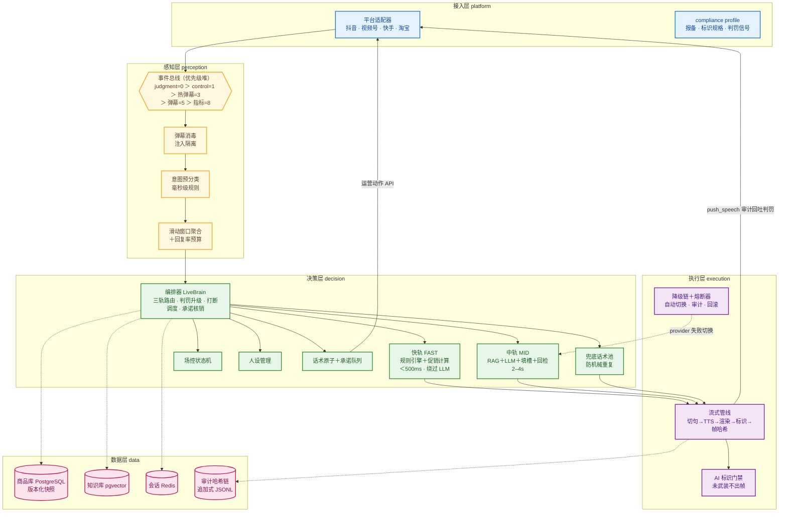
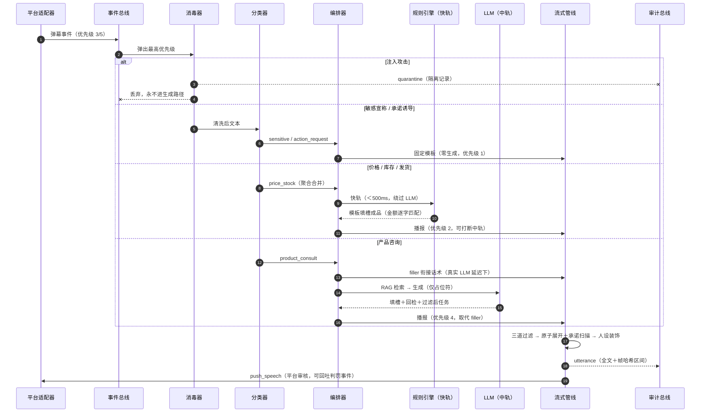
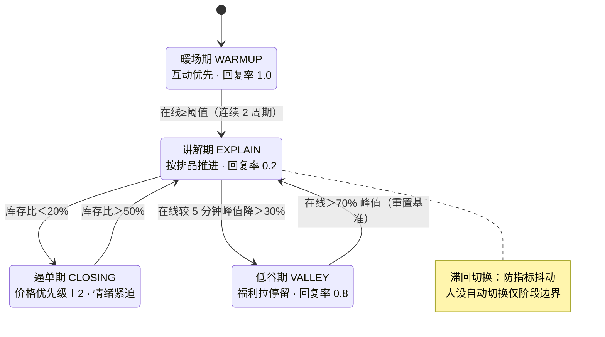
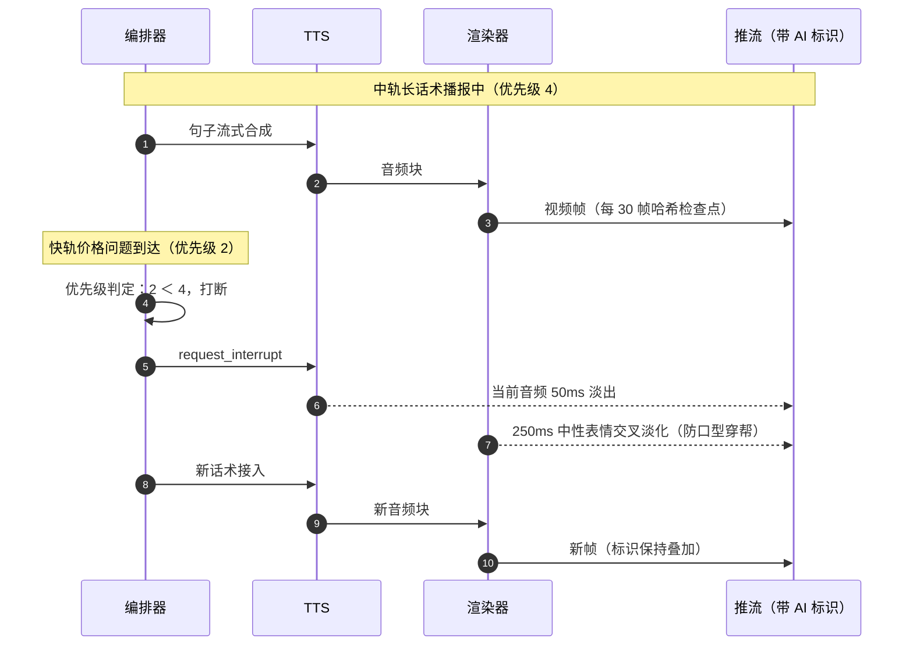
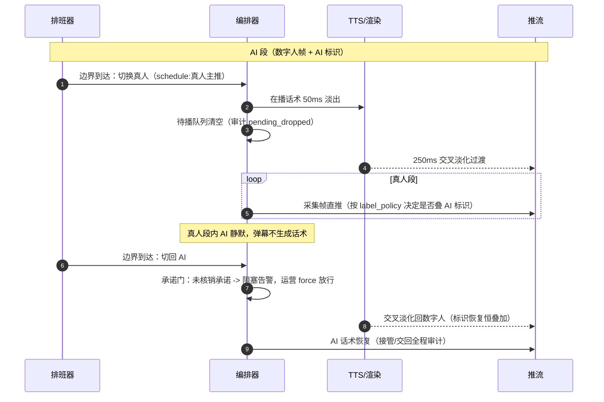
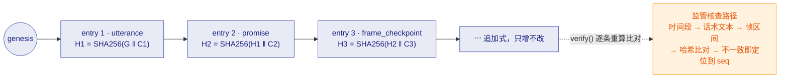
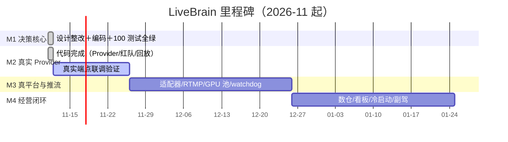
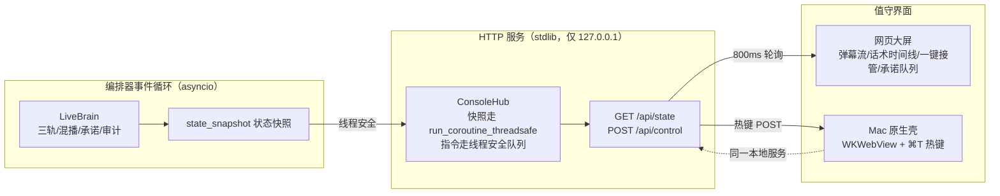
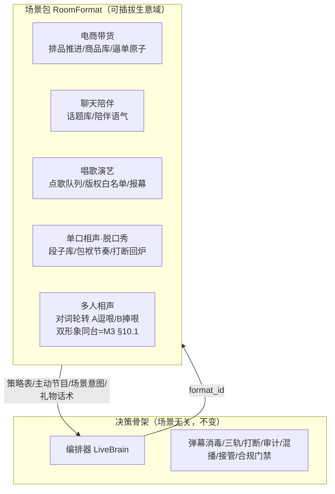

# 播控大脑（LiveBrain）设计 V4.1（整改版）

**副标题**：仿真人直播经营智能体 | **版本**：V4.4（V4.3 增补 + 直播场景包）
**合规基线**：《直播电商监督管理办法》（2026-02-01 施行）+ 各平台数字人专项规则
**状态**：设计定稿；M1 已交付、M2 代码完成、V4.2 混播/形象资产、V4.3 控制台、V4.4 场景包已交付（进度详见 [PROGRESS.md](PROGRESS.md)）

---

## 0. 整改说明：V4.0 → V4.1 改了什么

V4.0 评审结论：方向判断与分层架构成立，风险集中在「工程载体错配」与「直播特有失败模式」。V4.1 落实全部整改项：

| 编号 | 整改项 | V4.0 的问题 | V4.1 的做法 | 落实章节 |
|---|---|---|---|---|
| R1 | 运行载体两阶段 | 把 ZCode Hook/子智能体当生产事件循环，秒级延迟、多 session 常驻不可控 | 验证期 ZCode 原型；商用期自研常驻编排服务，子智能体 prompt 资产零损失平移 | §4 |
| R2 | 填槽制 | rule-engine 结果经主 LLM「合并输出」，数字重新暴露给生成路径 | LLM 只输出占位符（`{price}`），事实在生成后填入；LLM 全程不接触真实数字 | §6.3 |
| R3 | 三轨决策 | 单一 Agent 循环，无延迟分层 | 快轨（纯规则 <500ms）/ 中轨（RAG+LLM 2–4s）/ 慢轨（复杂推理 5–10s+filler） | §6.2 |
| R4 | 弹幕注入防护 | 完全缺失。直播是公开输入场，观众可直接对 LLM 注入 | 消毒器 + 意图白名单门卫 + 敏感问题固定拒答模板 + 红队回归集 | §5.2、§9 |
| R5 | 话术-动作绑定 | LLM 可自由生成"秒发/保证"类隐含承诺，说出口不兑现即事故 | 话术原子（utterance atom）携带 ops 副作用；承诺队列执行并核销；自由文本承诺词拦截 | §6.6 |
| R6 | 全链路兜底 | 只有插件级降级链，直播间整体可黑屏；且"循环录播兜底"本身违规 | 渲染崩→静态形象+TTS；LLM 熔断→大话术池（防机械重复）；推流双路；真人接管后默认不自动交回 | §7.5 |
| R7 | TTS 授权矩阵 | Edge TTS 进商用降级链（服务条款禁商用 + 端点不稳） | Edge TTS 仅限验证期与预合成素材；商用链只用有商用授权的实时 TTS | §7.2 |
| R8 | 帧审计降级承诺 | "确定性重渲染比对"跨硬件不可实现 | 录像留存（合规刚需）+ 哈希链防篡改；不承诺可重算复现 | §8.4 |
| R9 | 平台合规画像 | "画面角标"不满足部分平台醒目度要求；无报备/备案/判罚感知 | 适配器层带 compliance profile：报备流程、标识规格、判罚事件接入感知层触发升级 | §2、§3 |
| R10 | 人工动作审计 | 审计只覆盖 AI 话术，办法责任主体是运营者 | 运营发券/改价/切品/接管全部进不可变审计总线 | §8.3 |
| R11 | 品类宣称引擎 | 只有极限词过滤 | 按品类的宣称白名单/黑名单（食品禁功效宣称、保健需资质旗标等） | §6.5 |
| R12 | 数据新鲜度 | 价格/库存直读后 3 秒才播报，秒杀场景可能已错 | 快照版本+新鲜度校验，过期返回"确认中"话术；临界库存固定挂"以订单页为准" | §6.4 |
| R13 | 打断视觉过渡 | 50ms 音频淡出 + 视频硬切 = 口型穿帮 | 音频 50ms 淡出 + 渲染层 200–300ms 中性表情交叉淡化过渡段 | §7.4 |
| R14 | 多直播间资源层 | 只有"按优先级分配质量"一句 | 渲染器无状态化+状态快照、GPU 池调度、故障迁移从人设基线恢复 | §10 |

V4.0 保留不变的部分：合规作为架构前提不可绕过、数字走规则不走 LLM、插件化降级链思想、游戏能力移出商用首版、目标客户选"被坑过/合规敏感"的存量直播团队、SoulX-LiveAct（恒定显存）优先用于长时托管的选型逻辑。

### 0.1 V4.2 增补说明（混播引擎与形象资产，2026-11-11）

针对能力评审提出的四问（真人/数字人形象、主播个数、真人接管、AI+真人混播）：

| 编号 | 增补项 | 内容 | 章节 |
|---|---|---|---|
| V1 | 混播引擎 | 排班器 + 真人采集通道 + 画面切换（交叉淡化）+ 标识策略 + 承诺门 | §7.7 |
| V2 | 形象资产管理 | 形象库 + 肖像授权校验 + 平台报备绑定，接入开播门禁 | §8.6 |
| V3 | 单间双主播设计 | 多 persona 并行/双话术通道/轮转策略（设计就绪，实施 M3） | §10.1 |
| V4 | 多直播间 | 每间一个编排器实例（代码已支持），GPU 池调度 M3 | §10 |

已有能力对照：真人接管（M1 已交付）= 混播的时间分段形态；多直播间 = 横向多实例。

### 0.2 V4.3 增补说明（运营控制台，2026-11-11）

| 编号 | 增补项 | 内容 | 章节 |
|---|---|---|---|
| V5 | 网页运营控制台 | 零依赖 HTTP 服务 + 深色值守大屏（状态快照/弹幕流/话术时间线/一键接管/承诺队列/审计链） | §14 |
| V6 | Mac 原生应用 | WKWebView 壳 + 菜单热键（⌘T 接管/⌥⌘R 交回/⌥⌘A 恢复）+ 本地网络豁免 | §14.3 |
| V7 | Windows/移动端 | 路线图项（网页版已天然覆盖移动浏览器，原生端 M4 评估） | ROADMAP |

### 0.3 V4.4 增补说明（直播场景包，2026-11-11）

**直播不一定是卖货**：聊天、唱歌、单口相声、脱口秀、多人相声都是直播。核心判断：**决策骨架（三轨/消毒/打断/审计/混播/接管/合规门禁）场景无关，生意域做成可插拔场景包（RoomFormat）**——同一编排器，换包即换赛道。

| 编号 | 增补项 | 内容 | 章节 |
|---|---|---|---|
| V8 | 场景包架构 | RoomFormat 基类（场控策略表/主动推进/场景意图/礼物感谢/播报回调/互动模板）+ 五包注册表 | §15 |
| V9 | 五个场景包 | 电商（排品推进）/聊天（话题库）/唱歌（点歌队列+**版权白名单**）/单口相声·脱口秀（段子库+打断回炉）/多人相声（对词轮转，双形象 M3） | §15 |

---

## 1. 产品定位

**产品名**：播控大脑（LiveBrain）｜**副标题**：仿真人直播经营智能体

不做纯数字人播报器，做**人机协同的直播经营智能体**：AI 负责讲解、互动、节奏调控与合规兜底；人工负责异常接管与策略审核。一个运营同时管理多个直播间。

**商用边界（V4.1 明确）**：
- 首版只做电商带货闭环，不做游戏直播（观众对真实操作要求高，现阶段延迟与精度不达标）。
- 不承诺"纯无人直播"——平台明令禁止，产品形态强制人工值守。
- 第一批客户：已有直播运营团队、被 AI 翻车坑过、对合规极度敏感的中小品牌。

---

## 2. 合规硬约束（架构前提，不可绕过）

| 约束 | 依据 | 实现方式 | 不可绕过机制 |
|---|---|---|---|
| 显著 AI 标识 | 办法要求显著标识；部分平台要求标识醒目、角落小字不合规 | 标识按平台 compliance profile 配置（位置/占比/文案），叠加在合成画面 | 推流前门禁：标识未武装则管线拒绝出帧 |
| 开播报备 | 抖音等要求虚拟主播开播前报备，未报备不可开播 | 适配器层报备状态检查，未报备拒绝开播流程 | 接入层强制校验 |
| 算法/深度合成备案 | 平台要求 | 商用部署清单项，作为上线前检查单 | 部署门禁 |
| 真人值守/禁纯无人 | 抖音禁止纯 AI 无人直播、禁短周期机械重复录播 | 人工值守为产品前提；兜底话术池设计防机械重复判定 | 产品形态约束 |
| 人工接管热键 | 办法责任在运营者 | 后台常驻按钮：数字人静音+淡出，真人接管 | 决策层强制路由，接管后默认本场不自动交回 |
| 审计日志 | 平台须保存直播回放/互动信息；运营者自证需要 | 全量 AI 话术+人工操作不可变审计（哈希链） | 独立审计总线，追加式存储 |
| 录像留存 | 办法取证要求 | 平台侧留存 + 自留原始录像，哈希链关联 | 存储生命周期策略 |
| 判罚信号接入 | 平台限流/警告实时发生 | 判罚事件进感知层最高优先级，触发升级与 AI 降权 | 事件总线优先级 0 |

---

## 3. 总体架构：五层 + 三总线 + 自研编排器



逻辑分层（文本版，便于 diff 与无渲染环境阅读）：

```
┌────────────────────────────────────────────────────────────────────┐
│ 接入层  平台适配器（抖音/视频号/快手/淘宝）                          │
│         = 事件流 + 推流通道 + 运营动作 API + compliance profile     │
├────────────────────────────────────────────────────────────────────┤
│ 感知层  事件总线（优先级队列）                                       │
│         弹幕消毒（注入防护）→ 意图预分类 → 滑动窗口聚合 → 回复率预算  │
│         + 直播指标流 + 判罚事件 + 运营指令                            │
├────────────────────────────────────────────────────────────────────┤
│ 决策层  编排器 LiveBrain（自研常驻服务）                              │
│   快轨：规则引擎+模板+促销计算（<500ms，绕过 LLM）                    │
│   中轨：RAG+LLM+填槽+回检（2–4s）                                    │
│   慢轨：复杂推理（5–10s，filler 先行）                                │
│   场控调度器（阶段状态机）│ 人设/情绪管理 │ 话术原子+承诺队列           │
├────────────────────────────────────────────────────────────────────┤
│ 执行层  能力域插件总线：TTS│渲染│动作执行│AI标识│推流编码              │
│         每域降级链+熔断器；流式管线：切句→TTS→渲染→标识→推流           │
├────────────────────────────────────────────────────────────────────┤
│ 数据层  商品库(PostgreSQL)│知识库(pgvector)│会话(Redis)               │
│         直播数仓(ClickHouse)│审计日志(哈希链+录像留存)│插件注册表      │
└────────────────────────────────────────────────────────────────────┘
```

**三条总线**：

| 总线 | 职责 | 实现 |
|---|---|---|
| 事件总线 | 感知层→决策层统一输入，优先级排序 | 自研 asyncio 优先级队列（judgment=0 > control=1 > 高价值弹幕=3 > 普通弹幕=5 > 指标=8） |
| 插件总线 | 执行层能力域热切换 | Provider 接口 + 降级链 + 熔断器 + 审计 + 回滚 |
| 审计总线 | AI 话术与人工操作不可变记录 | 独立 AuditLog：追加式 JSONL + SHA256 哈希链 |

---

## 4. 运行载体：两阶段路线（R1，本次最大整改）

**验证期（M1–M2）**：自研编排器原型（本仓库 `livebrain/` 包），全 Provider 可 Mock，零外部依赖即可跑通端到端闭环与回归测试；ZCode 作为**开发工具链**用于代码生成、评审、测试迭代，不再作为运行时。

**商用期（M3+）**：同一编排器进程化为常驻服务：

- 每直播间一个编排器实例（进程或容器），多实例由资源调度器管理；
- 子智能体的角色定义（V4.0 的 `~/.zcode/agents/*.md`）平移为**角色化 prompt 资产**（`decision/` 内的 system prompt 片段），一份资产两处可用；
- ZCode 的 Hook 模式重实现为编排器内**中间件管线**：`UserPromptSubmit`≈感知注入中间件、`PreToolUse`≈推流前门禁、`Stop`≈出稿校验器（填槽完整性/承诺词/过滤，重试上限 1 次，超限落保守模板——绝不 3 次重试冷场）。

**为什么不用 ZCode 当运行时**（评审 P0-1 的结论存档）：agent 循环延迟秒级、session 面向单开发者、上下文压缩时机不可控、弹幕洪峰下 token 成本随观众数线性膨胀。

---

## 5. 感知层规格

### 5.1 输入源与标准事件

| 事件 | 优先级 | 来源 |
|---|---|---|
| judgment 判罚 | 0 | 平台适配器（限流/警告/禁言） |
| control 控制指令（接管/交回/切品/人设） | 1 | 运营后台 |
| danmu 弹幕（含购买意图） | 3 | 平台 WebSocket |
| danmu 弹幕（普通） | 5 | 平台 WebSocket |
| metric 指标（在线/库存比/转化） | 8 | 定时拉取 |
| enter/gift 进场/礼物 | 9 | 平台 WebSocket |

标准事件对象：`{kind, room_id, ts, priority, payload}`。

### 5.2 弹幕消毒器（R4，注入防护第一道）

弹幕是**公开的、对抗性的输入**，按不可信数据对待：

1. 控制字符剥离、长度截断（>120 字只取前 120）；
2. 注入模式匹配：`忽略(之前/上面)的指令`、`ignore all previous instructions`、`system:`/`assistant:`、`你现在是/扮演/开发者模式`、jailbreak 标记等 → **隔离**（quarantine），事件降级为 noise，**永不进入 LLM**，隔离记录进审计总线；
3. 意图白名单门卫：非白名单意图（指令类、诱导类）不进生成路径。

### 5.3 意图预分类（规则优先，纯本地毫秒级）

| 意图 | 路由 | 说明 |
|---|---|---|
| `price_stock` | 快轨 | 价格/库存/发货/优惠，子类型细分 |
| `product_consult` | 中轨 | 成分/适用/用法/对比 |
| `interact` | 低优先互动 | 按场控阶段回复率决定是否回应 |
| `sensitive` | **固定模板，零生成** | 治疗/降血糖/根治/疗效/孕妇禁忌等 |
| `action_request` | **固定模板，零生成** | "保证有效/秒发/假一赔十"诱导承诺 |
| `noise` | 丢弃 | — |

购买意图关键词（链接/怎么拍/下单）提升事件优先级。

### 5.4 滑动窗口聚合与回复率（R4 配套）

直播弹幕洪峰是常态，逐条回应既不可能也不自然：

- 同 topic（意图+子类型）在 15s 窗口内合并，一次回答覆盖（"好多宝宝在问价格～"）；
- 回复率预算：快轨 ≤15 次/分钟，LLM 轨 ≤6 次/分钟，超预算静默丢弃（场控阶段可调）；
- 高价值（购买意图）与 sensitive 不受预算限制。

---

## 6. 决策层规格

### 6.1 编排器路由

```
事件 → 消毒 → 分类
  sensitive/action  → 固定模板（立即出稿，优先级最高）
  price_stock       → 聚合 → 快轨（规则引擎，绕过 LLM）
  product_consult   → 聚合 → 中轨（RAG+LLM+填槽）；复杂对比 → 慢轨+filler
  interact          → 场控阶段回复率决定
出稿统一走：过滤三道 → 话术原子展开+承诺扫描 → 人设装饰 → 管线
```

打断策略：新话术优先级高于正在播报的（如快轨打断中轨），执行打断；接近句尾（最后一句最后一块）则不打断排队。

弹幕从到达至出稿的全链路时序：



### 6.2 三条快慢轨

| 轨道 | 路径 | 端到端目标 | 典型场景 |
|---|---|---|---|
| 快轨 | 规则+模板+促销计算，**完全绕过 LLM** | <500ms | 价格/库存/发货/优惠叠加 |
| 中轨 | RAG 检索→LLM 生成（仅占位符）→填槽→回检 | 2–4s（超时落保守模板） | 成分咨询、肤质适配 |
| 慢轨 | 复杂推理/多品对比 | 5–10s，先播 filler | "和 XX 比哪个好" |

filler 话术（"这个问题很好，我详细给她说下哈"）是等待期衔接的标准技巧，人设化且不含数字。

### 6.3 填槽制（R2，信任卖点的闭环）

**铁律强化：LLM 全程不接触真实数字。**

1. 中轨 system prompt 规定：输出中数字信息只能用占位符 `{price}` `{stock}` `{coupon}` `{ship_days}` `{online}`，禁止出现任何阿拉伯数字；
2. 生成后校验：未知占位符、未填占位符、自由文本含数字 → 拒绝，**重试 1 次**，再失败落保守模板；
3. 规则引擎把查询结果作为 facts 填入占位符；
4. 出稿校验器（Stop Hook 等价物）最终核对：占位符全部填充、无裸数字、无未绑定承诺词。

快轨模板本身含占位符，由规则引擎直接填充，零 LLM 参与。

### 6.4 规则引擎（数字的单一来源）

- 数据源：商品库结构化字段（价格/库存/SKU/优惠规则/资质旗标），带**版本号与时间戳**；
- 促销计算器：店铺满减+店铺券+平台券按声明顺序叠加，输出明细（金额绝不四舍五入到"吉利数"）；
- 新鲜度（R12）：快照年龄超阈值（默认 30s）→ 返回"稍等我确认下哈"并触发刷新，**不得播报过期数字**；
- 临界库存（<20%）固定追加"以订单页为准"兜底句；
- 查询超时/缺失 → "确认中"话术，禁止猜测。

### 6.5 三道过滤 + 品类宣称引擎（R11）

1. 绝对违禁词（黑名单，平台+商家自定义）；
2. 广告法极限词（最/第一/国家级/史上…）；
3. **品类宣称规则**：按商品类目的允许/禁止宣称清单——普通食品禁治疗/降血糖/抗癌等功效宣称；保健品类目须校验资质旗标（如蓝帽子）后才允许对应宣称；美妆禁医疗级表述。规则作为商品库结构化字段驱动。

### 6.6 话术原子与承诺队列（R5，防"空头支票"）

- **话术原子（utterance atom）**：模板+ops 副作用绑定，如 `[atom:link_up]` → "3、2、1，链接上了，直接拍！" + `OpsAction(link_up, sku)`；
- LLM/规则只能**引用原子 ID**，不能自由生成动作性承诺；
- 出稿扫描：自由文本中出现"保证/承诺/秒发/假一赔十/无效退款"且不来自原子模板 → 拦截；
- **承诺队列**：每个被播出的话术原子生成 Promise，由动作执行器调用平台运营 API（上链接/发券/改价）并核销；超时未核销 → 告警人工。全部状态进审计。

### 6.7 LLM 中轨与回检

- 检索（pgvector→M1 内存实现）→ 注入 prompt（标注"资料"）→ 流式生成 → 填槽 → **事实回检**：含宣称性关键词（含有/成分/适合/可以）的句子必须有关键词级别的检索片段支持，无支持则**丢弃该句**并记录拦截（幻觉率监控数据点）；
- LLM Provider 走降级链（见 7.6），全链熔断时切**兜底话术池**。

### 6.8 场控调度器（阶段状态机）

| 阶段 | 进入条件（带滞回，连续 2 个周期满足） | 策略 |
|---|---|---|
| 暖场期 WARMUP | 开播或在线 < 阈值 | 互动优先，讲品密度低，interact 回复率 1.0 |
| 讲解期 EXPLAIN | 在线稳定 | 按排品推进，interact 回复率 0.2 |
| 逼单期 CLOSING | 库存比 < 20% | 价格问题优先级 +2，情绪切紧迫，启用逼单原子 |
| 低谷期 VALLEY | 在线环比降 >30%（对 5 分钟峰值） | 福利/抽奖拉停留，interact 回复率 0.8 |

人设自动切换**仅允许**发生在阶段边界；手动切换单场 ≤3 次。



### 6.9 人设与情绪

persona = prompt 片段 + TTS style 映射 + 表情基线 + 允许场景 + 口头禅（装饰器必须数字无关，不破坏填槽校验）。切换即时生效于下一句，当前句播完过渡。

### 6.10 兜底话术池（R6 配套）

LLM 全链熔断时的大话术池：每品 ≥N 条变体、乱序播放、**通过占位符注入实时元素**（当前在线人数）避免"短周期机械重复"——这同时是平台反录播规则的合规设计。

---

## 7. 执行层规格

### 7.1 能力域接口契约

```python
# TTS
synthesize(text, style) -> AsyncIterator[AudioChunk]
# 渲染
run(audio_chunks, emotion) -> AsyncIterator[VideoFrame]   # 含 interrupt_transition()
# 动作执行
execute(action: OpsAction) -> ActionResult
```

### 7.2 TTS 授权矩阵（R7）

| 用途 | 允许 | 禁止 |
|---|---|---|
| 验证期动态话术 | Mock / Edge TTS（仅开发验证） | — |
| 预合成素材（固定开场白等） | Edge TTS 神经语音（预生成 MP3） | — |
| **商用动态实时话术** | 火山引擎 / Azure / MiniMax 等有商用授权的流式 TTS | **Edge TTS（服务条款禁商用且端点不稳定）** |

降级链商用默认：`[火山引擎, Azure, 商用备案音源]`，Edge TTS 不入链。

### 7.3 AI 标识门禁（推流前 Hook 等价物）

- 标识规格从平台 compliance profile 读取（文案/位置/最小占比），未满足的平台开播前置报备校验不通过；
- **门禁**：标识叠加未武装（armed）时，流式管线拒绝产出任何可推流帧——这是架构级不可绕过，不是配置项。

### 7.4 流式管线与打断（R13）

- LLM 流式输出按标点切句 → TTS 流式合成 → 渲染器边收音频块边出帧 → 标识叠加 → 推流；
- **打断协议**：高优先级话术到达 → 当前 TTS 音频 **50ms 淡出** → 渲染层播 **200–300ms 中性表情交叉淡化过渡段**（杜绝口型穿帮）→ 新话术接入；


- 帧哈希：每 30 帧（≈1s）一个检查点哈希，与当前话术 ID 绑定写入审计（见 8.4）。

### 7.5 全链路降级与熔断（R6）

| 故障 | 降级动作 |
|---|---|
| LLM 超时率超阈 | 熔断 → 兜底话术池（防重复设计）+ 告警 |
| 单 Provider 失败 | 熔断器（滑动窗口计数）→ 降级链下一家 + 审计 + 可回滚 |
| 渲染引擎崩 | 静态形象立绘 + TTS 实时合成继续（音频不死直播不死） |
| 推流断 | 双路推流、自动重连 |
| 判罚事件 | AI 降权（只走固定模板）+ 人工告警，**不自动恢复**，运营确认后恢复 |

### 7.6 人工接管与交回

- 热键接管：数字人音频淡出+画面过渡，真人接管，AI 静默；接管时刻的未核销承诺清点并提示人工；
- **交回**：默认本场不自动交回；人工确认交回时需状态摘要刷新（人设/当前品/价格版本/未核销承诺），全部进审计。

### 7.7 混播引擎（V4.2 增补）：AI 与真人同场

平台推荐"真人+数字人混播"路线（打击纯无人），混播是商用主形态而非可选项。

**组成**（`livebrain/mixed/` + 管线扩展）：

| 部件 | 职责 | 实现 |
|---|---|---|
| 排班器 MixedSchedule | 时段表驱动 AI/真人切换（如"AI 讲长尾品 10 分钟 → 真人主推 30 分钟 → AI 返场"） | 边界跨越发模式切换事件，与手动接管共用统一入口 |
| 真人采集通道 HumanCapture | 摄像头帧/麦克风 | M1 Mock（25fps 真实节奏）；M3 接 OpenCV/采集卡/NDI |
| 画面切换 | 复用打断过渡段的**交叉淡化**，杜绝画面硬切 | begin/end_human_mode：过渡段 + 视觉源切换留痕 |
| 标识策略 | AI 标识跟随内容源 | label_policy：`ai_content_only`（默认，真人采集帧不叠——非 AI 生成内容）/ `always`（保守全时段叠加） |
| 承诺门 | 排班切回 AI 走 rehandoff 语义 | 未核销承诺阻塞并告警，保持真人画面，运营 force 放行 |

**切换语义**：切入真人 = 在播话术 50ms 淡出 + 待播队列清空（审计 `pending_dropped`）+ 画面交叉淡化；真人段内 AI 静默（弹幕不生成话术），真人帧照常进哈希审计链（混播内容全程可追溯）。



---

## 8. 数据层规格

### 8.1 商品库

结构化字段：价格/库存/SKU 参数/优惠规则/**品类宣称规则/资质旗标**，快照版本+时间戳。M1 内存实现，接口按 PostgreSQL 设计。仅规则引擎可写路由（LLM 轨只读知识库与结构化快照，不直连数字字段）。

### 8.2 知识库

卖点/FAQ/售后政策，向量检索（M1 关键词打分，M2 pgvector）。健康度：未回复问题清单+回检拦截清单驱动每日补充。

### 8.3 审计总线（R10）

记录类型：`utterance`（AI 话术全文+触发来源+facts+话术轨道+起止时间+帧区间哈希）、`quarantine`（注入隔离）、`provider_switch`、`promise`（创建/执行/核销/超时）、`judgment`、`takeover/rehandoff/human_ops`（人工动作）、`stage_change`、`persona_switch`。追加式 JSONL + 内存哈希链。

### 8.4 帧级追溯 v2（R8）

- **录像留存**：原始推流录像留存（合规本身要求），对象存储+生命周期策略；
- **哈希链**：每话术关联其推流帧区间，帧检查点哈希 `sha256(prev_hash + frame_idx + room + utterance_id + scene)` 形成链；
- **核查流程**：时间段 → AI 话术文本 → 帧区间 → 与留存的录像/哈希链比对；
- **不承诺**：跨硬件确定性重渲染复现（不可实现），"可证明未篡改"由追加式存储+哈希链达成。



### 8.5 直播数仓

ClickHouse：弹幕时间线、AI 回复及来源轨道、转化事件、讲品节奏对齐 → 话术效果热力图。M4。

### 8.6 形象资产管理（V4.2 增补）

平台规则要求：使用真人形象（含明星）做数字人底模必须核验完整肖像权授权；虚拟形象须完成报备。形象资产作为一等数据管理：

- **AvatarAsset**：`kind`（digital_human 纯生成形象 / real_person_model 真人底模）、底模引用、肖像授权（`Authorization`：文件引用/授权人/范围/**有效期**）、平台报备绑定（platform → 报备记录号）、关联人设；
- **开播门禁（与 AI 标识门禁同级，不可绕过）**：
  - 真人底模：无授权或授权过期 → 拒绝开播（`authorization_missing / authorization_expired`）；
  - 平台要求形象报备而未绑定 → 拒绝开播（`registration_missing`）；
- 授权临期提醒进运营告警（M3 接入健康度看板）；
- M1 内存实现，M2+ 平移 PG（并入 `deploy/schema.sql`）。

---

## 9. 安全与红队（R4）

- **威胁模型**：观众通过弹幕注入指令、诱导违规表述、诱导承诺；
- 防线：消毒器隔离 → 意图白名单 → sensitive/action 固定模板（零生成）→ 出稿校验兜底；
- **红队弹幕集**：作为回归测试资产入库（`tests/test_injection_guard.py` 等），每次 prompt/模板变更全量回归；
- 隐私：弹幕含用户 PII，最小化留存字段；LLM 调用默认国产/自托管端点，禁止默认外传。

---

## 10. 多直播间资源层（R14）

- 渲染器**无状态化**：可重放状态=（人设基线+当前情绪+当前话术 ID），崩溃后从备用 GPU 以基线恢复，推流器与渲染器解耦保证流不断；
- GPU 池：按直播间优先级分配渲染质量档位（Lite 多路 / Pro 高画质 / LiveAct 长时）；
- 每间一个编排器实例，资源调度器统一监控（直播间健康度看板：中断次数/打断延迟分布/规则查询成功率/回检拦截率/哈希链异常数）。

### 10.1 单间双主播设计（V4.2 设计就绪，实施 M3）

当前为单话术流模型（persona = 同一形象的语气切换）。双主播/助播需扩展为**多通道模型**：

| 扩展点 | 设计 |
|---|---|
| 多 persona 并行 | 每主播独立 persona（prompt/TTS style/表情基线），互不覆盖 |
| 双话术通道 | 每通道独立 TTS+渲染实例与打断域：**打断只在本通道内生效**，跨通道为"接话"（新通道话术排队等待对方句尾） |
| 轮转策略 | 场控增加轮转维度：主讲/助讲切换信号（排品节点、弹幕热度、固定节奏）；轮转切换复用混播交叉淡化 |
| 帧合成 | 画中画/并排合成器进管线（渲染层之上的合成 Provider） |
| 不变的部分 | 承诺队列、审计哈希链、合规门禁、话术原子均为主播无关，天然多主播兼容 |

实施集中在编排器（多通道调度）与管线（合成器），M3 与真平台推流一起落地。

---

## 11. 里程碑与验收



| 里程碑 | 内容 | 验收标准 | 状态 |
|---|---|---|---|
| **M1** | 编排器+三轨+填槽+消毒+原子承诺+过滤+场控+人设+审计哈希链+流式管线与打断+降级熔断+模拟平台+接管；全 Provider Mock，零外部依赖 | 全部单测/集成测试绿；模拟直播间端到端跑通：正常问答/注入隔离/敏感拒答/幻觉拦截/承诺执行/判罚升级/降级切换/打断 | ✅ 已交付（100 测试全绿） |
| **M2** | 真实 Provider：OpenAI 兼容 LLM（Ark 等）、EdgeTTS（验证期）、filler 调度；PG+pgvector DDL 与部署物料；红队弹幕集；回放测试工具 | 真实模型下填槽校验拦截率=100%（数字不泄露）；回放集回归绿 | 🔶 代码完成（离线 100 测试绿；真实端点联调待 API Key） |
| **V4.2 增补** | 混播引擎（排班/采集/画面切换/标识策略/承诺门）+ 形象资产管理（授权/报备开播门禁）+ 双主播设计 | 混播切换全程留痕可审计；未授权形象拒绝开播；双主播设计评审通过 | ✅ 已交付（17 个新测试，总数 117 全绿） |
| M3 | 真平台适配（首发一家）+ RTMP 推流 + 多直播间 GPU 调度 | 连续 4 小时模拟推流稳定；打断端到端 <1.5s | ⏳ 待启动（需平台开放者资质与 GPU 环境） |
| M4 | 数仓/健康度看板、冷启动 ASR 工具（历史直播→QA 抽取）、副驾模式灰度 | 看板指标齐；副驾模式试点 | ⏳ 待启动 |

---

## 12. 代码地图（M1+M2 已实现部分）

```
livebrain/
├── util.py                    Clock（可缩放时钟）/canonical_json/sha256
├── config.py                  Settings：降级链/预算/阈值/熔断参数/filler 开关
├── events.py                  标准事件对象与优先级
├── bus.py                     事件总线（heapq 优先级队列）
├── scenarios.py               演示/回放共用剧本（所见即所测）★M2
├── perception/
│   ├── sanitizer.py           弹幕消毒器（注入隔离，红队集回归）
│   ├── classifier.py          意图预分类（sensitive/action/购买意图）
│   └── aggregator.py          滑动窗口聚合 + 回复率预算
├── decision/
│   ├── slots.py               填槽制核心（占位符校验/填充/裸数字拦截）
│   ├── rule_engine.py         快轨：规则+模板+促销计算+新鲜度
│   ├── knowledge_store.py     知识库（关键词检索，M2 换 pgvector）
│   ├── llm_agent.py           中轨：RAG+LLM+填槽+回检+超时兜底
│   ├── fallback.py            兜底话术池（防机械重复）
│   ├── atoms.py               话术原子 + 承诺队列
│   ├── filters.py             三道过滤 + 品类宣称引擎
│   ├── field_controller.py    场控阶段状态机（滞回）
│   └── persona.py             人设管理（切换约束+数字无关装饰）
├── execution/
│   ├── tts.py                 TTS 接口 + Mock + EdgeTTS（验证期）★M2
│   ├── llm_openai_compat.py   OpenAI 兼容 LLM Provider（Ark 等）★M2
│   ├── renderer.py            渲染接口 + Mock（含过渡帧/帧哈希）
│   ├── compliance.py          AI 标识门禁
│   ├── pipeline.py            流式管线：切句→TTS→渲染→标识→帧哈希；打断协议
│   └── degradation.py         熔断器 + 能力降级链（审计+回滚）
├── data/
│   ├── product_store.py       商品库（版本化快照+促销规则+资质旗标）
│   ├── avatar_store.py        形象资产（授权/报备/开播门禁）★V4.2
│   ├── session.py             会话状态
│   └── audit.py               审计总线（JSONL+SHA256 哈希链+verify）
├── mixed/
│   ├── schedule.py            混播排班器（时段表驱动 AI/真人切换）★V4.2
│   └── capture.py             真人采集通道（M1 Mock 25fps）★V4.2
├── platform/
│   └── mock_platform.py       模拟平台：弹幕脚本/判罚信号/运营动作/真人采集/形象绑定
├── ops/takeover.py            人工接管/交回（含状态摘要）
└── orchestrator.py            LiveBrain 编排器（三轨路由/判罚升级/打断调度/filler）★filler

assets/redteam_danmu.jsonl     红队弹幕集（40 条：注入/敏感/诱导/正常）★M2
tools/replay.py                回放测试工具（录制/回放/四不变量校验）★M2
deploy/                        schema.sql（PG+pgvector DDL）/ docker-compose / config.example ★M2
tests/                         19 个测试文件，117 个用例全绿
demo/run_demo.py               模拟直播间演示（全场景一条龙）
```

---

## 13. 风险与应对（更新版）

| 风险 | 应对 |
|---|---|
| 平台判定纯数字人/录播违规 | 强制值守+热键接管+显著标识+报备前置+兜底池防机械重复 |
| LLM 幻觉 | 填槽制（数字零接触）+事实回检+拦截率监控 <3% |
| 弹幕注入/诱导 | 四层防线+红队回归集（§9） |
| AI 空头承诺 | 话术原子+承诺队列+自由承诺词拦截（§6.6） |
| 仿真人长时崩坏 | 长时托管选 LiveAct（恒定显存）；渲染无状态化+快速恢复 |
| 插件切换中断 | 降级链+熔断+审计+一键回滚；渲染崩走"立绘+TTS" |
| 审计被质疑 | 录像留存+哈希链，可证明未篡改（不承诺重渲染） |
| 多间 GPU 成本 | Lite 多路/LiveAct 恒定显存；按优先级分配画质档 |
| TTS 商用合规 | 授权矩阵（§7.2），Edge TTS 不入商用链 |
| 数据新鲜度/超卖 | 版本化快照+新鲜度校验+"以订单页为准"兜底 |

---

## 14. 运营控制台（V4.3 增补）

人工值守是产品前提（§2），值守必须有趁手的台子。控制台是编排器的运营面：

### 14.1 架构



### 14.2 网页控制台（`livebrain/console/`）

- **启动**：`python3 -m livebrain.console` → http://127.0.0.1:8765
- **API**：`GET /api/state`（快照：阶段/人设/模式/画面源/弹幕流含意图与隔离标记/话术时间线含打断/承诺队列/判罚/告警/降级链/审计链校验/排班状态）；`POST /api/control`（takeover / rehandoff / resume / persona_switch / switch_product / human_ops / demo_schedule）
- **面板**：直播画面区（数字人/真人画面源切换 + AI 标识叠加状态可视化）、弹幕流（注入隔离红色划线）、话术时间线（快轨/中轨/模板/兜底 + ⚡打断标记）、运营操作区（接管大红键、人设/切品/发券/演示排班）、承诺队列、告警与判罚、审计链校验徽标
- **实时源**：运行时以真实节奏生成弹幕流（约 8% 概率混入红队样例，防护在线可见）
- **安全**：仅绑定 127.0.0.1，不对外网暴露；指令白名单校验

### 14.3 Mac 原生应用（`mac/`）

- WKWebView 承载同一本地控制台（ATS 仅豁免本地网络）；
- 菜单热键：⌘T 接管、⌥⌘R 交回、⌥⌘A 判罚后恢复、⌘R 重载；
- `mac/build.sh`（swiftc 编译 + 临时签名）/ `mac/run.sh`（自动拉起服务并打开应用）；
- Windows 壳与移动原生端：网页版天然覆盖移动浏览器，原生壳 M4 评估（WebView2/Tauri 路线）。

---

## 15. 直播场景包（V4.4 增补）：直播不一定是卖货

### 15.1 架构



场景包接口（`livebrain/formats/base.py`）：`stage_strategies`（覆盖四阶段策略与情绪）、
`proactive`（**冷场主动上节目**——排品/话题/报幕/段子/对词，无人提问也要持续播）、
`handle_song_request / handle_joke_request`（场景意图，非对应场景礼貌婉拒）、
`gift_thanks`、`interact_reply`（场景化互动模板）、`on_speech_done`（打断回炉等）。

### 15.2 场景矩阵

| 场景 | 主动节目 | 场景意图 | 场景专属合规 | 备注 |
|---|---|---|---|---|
| 电商带货 | 排品推进（防重复池） | 购买/优惠 | 品类宣称引擎/资质旗标 | 全量能力见 §5–§8 |
| 聊天陪伴 | 话题库轮转 | — | 防情感依赖提示（模板基调） | 陪伴语气人设 |
| 唱歌演艺 | 报幕/点歌引导 | **点歌**（入队/婉拒） | **音乐版权白名单=授权曲库**，未授权曲目礼貌婉拒 | 演唱/伴奏音轨 M3 接入，当前为报幕话术 |
| 单口相声·脱口秀 | 段子库轮转（setup/punch 结构） | **讲段子** | 段库审读（入库前人工过审） | **打断的段子不算讲完，回炉重讲** |
| 多人相声 | 对词脚本轮转（A 逗哏/B 捧哏） | 来一段/返场=续演 | 段库审读 | 单通道声音轮换演绎；双形象同台走 M3 双主播通道 |

**关键合规点**：场景无关的防护（注入隔离/敏感拦截/审计/标识门禁）对娱乐场景同样生效——
娱乐直播间里"能降血糖吗"照样走固定拒答模板，注入攻击照样隔离；唱歌场景的版权白名单
是硬约束（未授权曲目不得演唱），与电商的品类宣称引擎同级。

### 15.3 使用

```bash
python3 -m livebrain.console --format standup     # 单口相声·脱口秀
python3 -m livebrain.console --format music       # 唱歌（点歌+版权白名单）
python3 -m livebrain.console --format chat        # 聊天陪伴
python3 -m livebrain.console --format crosstalk   # 多人相声（对词轮转）
```

冷场约 0.8 秒自动上节目（噪音弹幕不清零冷场计数）；控制台顶栏显示场景与场景化阶段名
（垫话开场/正活进行中/压轴大段…）。自定义场景包：继承 RoomFormat 并 register（见
`livebrain/formats/packs.py` 示例）。

---

**核心判断**（V4.0 保留 + V4.1–V4.4 演进）：合规是入场券；**填槽制让"数字绝不经过 LLM"从纪律变成机制**；打断响应是体验底线；自研编排器承载多 Agent 并发；话术原子让 AI 永不开空头支票；**场景包让"卖货"只是直播的一种**——聊天、唱歌、相声共享同一套防护、审计与值守体系。第一批客户是已有运营团队、被 AI 坑过、合规敏感的中小品牌。
