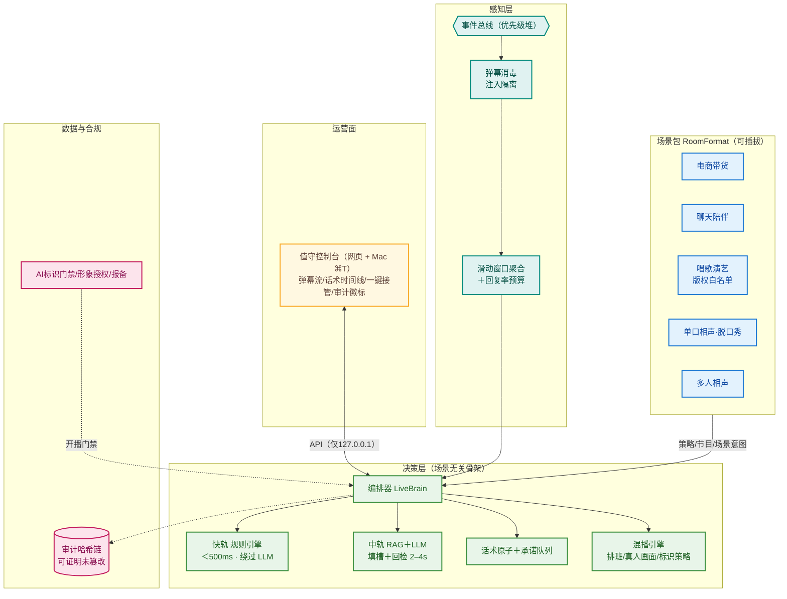

# 播控大脑 LiveBrain

**仿真人直播经营智能体**——人机协同：AI 负责讲解、互动、节奏与合规兜底，人工负责异常接管与策略审核。

> 当前状态：**M1 + V4.2/V4.3/V4.4 已交付，M2 代码完成** ｜ 134 测试全绿 ｜ 零运行时依赖（Python 3.9+，纯标准库）
> 读者路径：**运营** → [直播场景](#直播场景v44直播不一定是卖货) / [如何在直播中使用](#如何在直播中使用运营视角) ｜ **开发者** → [30 秒感受](#30-秒感受) / [目录结构](#目录结构)

## 30 秒感受

```bash
python3 demo/run_demo.py          # 全场景演示：注入攻击/幻觉拦截/承诺核销/判罚升级/打断/混播/接管
python3 -m livebrain.console      # 运营控制台大屏：http://127.0.0.1:8765（值守/接管/审计实时可见）
```

## 文档索引

| 文档 | 内容 |
|---|---|
| [DESIGN.md](DESIGN.md) | V4.4 完整设计：V4.0 评审 R1–R14 整改 + V1–V9 增补对照，11 张架构图 |
| [PROGRESS.md](PROGRESS.md) | 进度事实源：里程碑/增补明细/质量指标/风险看板/变更日志 |
| [docs/USAGE.md](docs/USAGE.md) | 值守手册 SOP：开播检查清单/大屏解读/操作时机/异常处理/复盘 |
| [ROADMAP.md](ROADMAP.md) | M1–M4 路线与验收标准 |

## 直播场景（V4.4）：直播不一定是卖货

决策骨架（三轨/消毒/打断/审计/混播/值守）**场景无关**，生意域是可插拔**场景包**——同一编排器，换包即换赛道：

```bash
python3 -m livebrain.console                        # 电商带货（默认）
python3 -m livebrain.console --format chat          # 聊天陪伴：话题库冷场自动接续
python3 -m livebrain.console --format music         # 唱歌演艺：点歌入队+版权白名单（未授权婉拒）
python3 -m livebrain.console --format standup       # 单口相声·脱口秀：段子库轮转，被打断的段子回炉重讲
python3 -m livebrain.console --format crosstalk     # 多人相声：对词轮转（A逗哏/B捧哏），双形象同台=M3
```

冷场约 0.8 秒自动上节目（排品/话题/报幕/段子/对词）；礼物感谢、点歌、段子请求场景化应答；**场景无关的防护对娱乐场同权生效**（注入隔离/敏感拦截/审计/标识门禁）。自定义场景包：继承 `formats.RoomFormat` 注册即可（`livebrain/formats/packs.py` 有五个范例）。

## 如何在直播中使用（运营视角）

### ① 直播前 · 10 分钟准备

**第一步：准备直播间数据**（一个 JSON 搞定，按场景取用，示例见 `config/room.example.json`）

| 场景 | 要准备什么 | JSON 块 |
|---|---|---|
| 电商带货（默认） | 商品库 + 知识库（价格单位=元） | `"products"` + `"knowledge"` |
| 唱歌演艺 | **授权曲库白名单**（版权硬约束，未授权曲目自动婉拒） | `"music": {"whitelist": [...]}` |
| 单口相声·脱口秀 | 你的段子（setup + 包袱） | `"standup": {"jokes": [...]}` |
| 多人相声 | 对词本（A=逗哏 / B=捧哏） | `"crosstalk": {"script": [...]}` |
| 聊天陪伴 | 话题库 | `"chat": {"topics": [...]}` |

场景内容块按 `--format` 生效（同一份文件可同时存多场景内容）；不准备也能开播，用内置演示内容。

**第二步：启动值守控制台**

```bash
cp config/room.example.json my_room.json    # 改成你的内容

python3 -m livebrain.console --data my_room.json                        # 电商带货
python3 -m livebrain.console --data my_room.json --format music         # 唱歌演艺
python3 -m livebrain.console --data my_room.json --format standup --real-llm   # 接真实大模型
```

接真实大模型（火山方舟/DeepSeek/vLLM 任意 OpenAI 兼容端点）需环境变量：
`ARK_API_KEY`、`LIVEBRAIN_LLM_BASE_URL`、`LIVEBRAIN_LLM_MODEL`；失败自动熔断回落，直播不中断。

打开 **http://127.0.0.1:8765**（或 `mac/run.sh` 用 Mac 原生应用，⌘T 接管热键）。
开播自检自动执行：平台报备、形象授权、AI 标识门禁——任一不过直接拒绝开播。

### ② 直播中 · 值守（详见 [docs/USAGE.md](docs/USAGE.md)）

| 看哪里 | 说明 |
|---|---|
| 直播画面区 | 数字人 ↔ 真人画面源切换实时可见；AI 标识叠加状态可视化 |
| 弹幕流 | 每条带意图标签；**红色划线=注入攻击，已自动隔离**，无需处理 |
| 话术时间线 | 快轨(蓝)/中轨(绿)/模板(紫)/兜底(橙) + ⚡被打断标记；价格话术来自规则引擎逐字匹配 |
| 告警/判罚栏 | 橙色横幅=平台判罚降权中，AI 已自动切保守话术 |

**什么时候动手**：判罚横幅 → 处理后点"确认恢复"；想真人讲 → 大红键/**T 键**接管；交回被
`REHANDOFF_BLOCKED` 挡住 → 承诺队列有未核销动作，人工补执行后交回；库存 <20% 自动进逼单期无需动作。
**你的每个动作同样进审计哈希链。**

### ③ 直播后 · 复盘核查

```bash
python3 tools/replay.py record --out session.jsonl   # 录制本场弹幕
python3 tools/replay.py check  --in  session.jsonl   # 四不变量回归（哈希链/注入隔离/出稿干净/承诺核销）
```

### 当前边界（诚实说明）

数字人渲染（MuseTalk/SoulX）与真平台 RTMP 推流属 **M3**（需平台开放者资质 + GPU）。
**今天即可用**：真实大模型半实况（`--real-llm`）、五种直播场景演练、团队值守培训、话术与合规
回归、审计与混播机制演示。M3 就绪后值守操作与今天完全一致。

## 架构一图流



## 核心机制（与竞品的本质差异）

**信任底线**
1. **填槽制**：LLM 只输出 `{price}` 占位符，数字在生成后由规则引擎填入——幻觉数字在机制上不可能出稿（测试断言 "199" 永不出现）。
2. **话术原子＋承诺队列**："上链接"类话术自带运营动作副作用，说出口必核销，AI 永不开空头支票；自由文本承诺词一律拦截。
3. **审计哈希链**：AI 话术＋人工操作＋帧检查点全部追加式入链，`verify()` 可定位任意事后篡改。

**防护底线**

4. **弹幕消毒**：直播是公开对抗输入场，注入弹幕隔离后永不进入 LLM（40 条红队集全量回归）。
5. **品类宣称/版权白名单**：食品禁功效宣称、保健需资质旗标、未授权曲目不得演唱——按生意域配置的合规硬约束。

**直播能力**

6. **打断协议**：快轨 50ms 音频淡出 + 250ms 视觉交叉淡化接管中轨，杜绝口型穿帮与冷场。
7. **混播引擎**：排班式 AI/真人切换（承诺门交接）、真人画面接入、AI 标识跟随内容源。
8. **场景包**：五种直播赛道共享同一套防护、审计与值守体系，自定义场景一个类搞定。

## 目录结构

```
livebrain/                核心包（纯标准库）
├── orchestrator.py         编排器：三轨路由/判罚升级/打断调度/承诺核销/混播切换/场景包驱动
├── perception/             弹幕消毒（注入隔离）/ 意图分类 / 聚合与回复率预算
├── decision/               填槽 / 规则引擎 / LLM中轨 / 原子承诺 / 过滤 / 场控 / 人设 / 兜底池
├── execution/              TTS / LLM（OpenAI兼容）/ 渲染 / 合规门禁 / 流式管线 / 熔断降级链
├── formats/                直播场景包：电商/聊天/唱歌/单口相声·脱口秀/多人相声（可插拔）
├── mixed/                  混播引擎：排班器 + 真人采集通道
├── console/                运营控制台：HTTP 服务 + 实时运行时 + 网页大屏 + 数据装载
├── data/                   商品库 / 形象资产（授权/报备）/ 知识库 / 会话 / 审计哈希链
├── platform/               模拟平台（判罚信号/运营动作/真人采集/形象绑定）
├── ops/                    人工接管与交回
└── scenarios.py            演示与回放共用剧本
mac/                      Mac 原生应用（Swift/WKWebView + ⌘T 热键 + 构建脚本）
config/                   room.example.json 直播间数据示例
assets/                   红队弹幕集（40 条，回归资产）
tools/replay.py           回放测试工具（四不变量校验）
deploy/                   PG+pgvector DDL / docker-compose / 配置样例
docs/USAGE.md             值守手册 SOP
tests/                    22 文件 134 用例
demo/                     全场景演示
```

## 开发者

```bash
python3 -m pytest tests/ -q                              # 134 用例全离线
python3 -m pytest tests/test_e2e.py -q                   # 端到端模拟直播间
```

接入真实能力（全部是 Provider 接口插拔，决策层零改动）：

| 能力 | 入口 | 说明 |
|---|---|---|
| LLM | `execution/llm_openai_compat.py` | 任意 OpenAI 兼容端点（火山方舟/DeepSeek/vLLM），凭据走环境变量 |
| TTS | `execution/tts.py` | EdgeTTS 仅验证期/预合成；商用实时链路须接有授权的流式 TTS |
| 渲染 | `execution/renderer.py` | MuseTalk/SoulX Provider（需 GPU），打断过渡段接口已定义 |
| 真人采集 | `mixed/capture.py` | OpenCV/采集卡替换 MockHumanCapture |
| 场景包 | `formats/packs.py` | 继承 RoomFormat 注册，五个范例可抄 |
| 数据层 | `deploy/schema.sql` | PG+pgvector DDL 与内存实现一一对应 |

## 合规内建（不可绕过）

显著 AI 标识门禁（未武装不出帧；混播下标识跟随内容源）· 开播报备前置校验 · 形象授权门禁（真人底模无授权/过期拒绝开播）· **版权白名单**（未授权曲目不得演唱）· 品类宣称引擎（食品禁功效/保健需蓝帽子）· 禁纯无人形态 · 兜底话术池防"机械重复录播"判定 · 人工接管热键与交回承诺清点 · 全量操作审计。详见 [DESIGN.md](DESIGN.md) 第 2、7.7、8.6、15 章。
