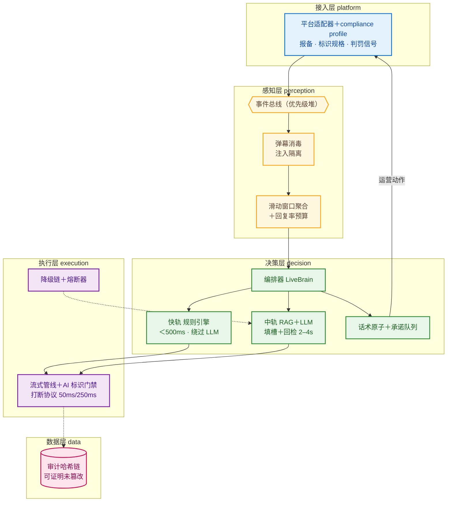

# 播控大脑 LiveBrain

**仿真人直播经营智能体 · V4.1 整改版 · 自研编排核心**

人机协同的直播经营智能体：AI 负责讲解、互动、节奏调控与合规兜底，人工负责异常接管与策略审核。**合规是入场券，规则引擎是信任底线，打断响应是体验底线。**

| | |
|---|---|
| 设计文档 | [DESIGN.md](DESIGN.md)（V4.1 完整设计，含 R1–R14 整改对照表 + 6 张架构图） |
| 项目进度 | [PROGRESS.md](PROGRESS.md)（里程碑总览 / M2 明细 / 质量指标 / 风险看板 / 变更日志） |
| 路线图 | [ROADMAP.md](ROADMAP.md)（M1–M4 验收标准） |
| 当前状态 | **M1 已交付 · M2 代码完成**：100 测试全绿，零运行时依赖（Python 3.9+） |

## 架构一图流



## 快速开始

```bash
# 全量测试（100 个，离线可跑）
python3 -m pytest tests/ -q

# 模拟直播间演示：注入攻击/敏感拦截/幻觉拦截/承诺核销/判罚升级/降级切换/打断
python3 demo/run_demo.py

# 回放测试工具（CI 可用：违反不变量则退出码 1）
python3 tools/replay.py record --out /tmp/session.jsonl
python3 tools/replay.py check  --in  /tmp/session.jsonl
```

仅依赖 Python 3.9+ 标准库；`edge-tts` 为可选依赖（验证期 TTS）；pytest 仅测试需要。

## 信任四件套（与竞品的本质差异）

1. **填槽制**：LLM 只输出 `{price}` 占位符，数字在生成后由规则引擎填入——幻觉数字在机制上不可能出稿（测试断言 "199" 永不出现）。
2. **话术原子＋承诺队列**："上链接"类话术自带运营动作副作用，说出口必核销，AI 永不开空头支票；自由文本承诺词（保证/秒发/假一赔十）一律拦截。
3. **弹幕消毒**：直播是公开对抗输入场，注入弹幕隔离后永不进入 LLM（40 条红队集全量回归）。
4. **审计哈希链**：AI 话术＋人工操作＋帧检查点全部追加式入链，`verify()` 可定位任意事后篡改。

## 目录结构

```
livebrain/            核心包（27 模块）
├── orchestrator.py     编排器：三轨路由/判罚升级/打断调度/承诺核销/filler
├── perception/         消毒（注入隔离）/ 意图分类 / 聚合与回复率预算
├── decision/           填槽 / 规则引擎 / LLM中轨 / 原子承诺 / 过滤 / 场控 / 人设 / 兜底池
├── execution/          TTS（Mock+EdgeTTS）/ LLM（OpenAI兼容）/ 渲染 / 合规门禁 / 流式管线 / 熔断降级链
├── data/               商品库 / 知识库 / 会话 / 审计哈希链
├── platform/           模拟平台（判罚信号/运营动作）
├── ops/                人工接管与交回
└── scenarios.py        演示与回放共用剧本
assets/                 红队弹幕集（40 条，回归资产）
tools/replay.py         回放测试工具（四不变量校验）
deploy/                 PG+pgvector DDL / docker-compose / 配置样例
tests/                  17 文件 100 用例
demo/                   全场景演示
```

## 接入真实能力（M2 联调指引）

| 能力 | 入口 | 说明 |
|---|---|---|
| LLM | `execution/llm_openai_compat.py` | 任意 OpenAI 兼容端点（火山方舟/DeepSeek/vLLM），凭据走环境变量 `ARK_API_KEY` |
| TTS | `execution/tts.py` | EdgeTTS 仅验证期/预合成；商用实时链路须接有授权的流式 TTS |
| 渲染 | `execution/renderer.py` | MuseTalk/SoulX Provider（需 GPU），打断过渡段接口已定义 |
| 数据层 | `deploy/schema.sql` | PG+pgvector DDL 与内存实现一一对应，切换零决策层改动 |

## 合规内建（不可绕过）

显著 AI 标识门禁（未武装不出帧）· 开播报备前置校验 · 禁纯无人形态 · 兜底话术池防"机械重复录播"判定 · 人工接管热键与交回承诺清点 · 全量操作审计。详见 [DESIGN.md](DESIGN.md) 第 2 章。
