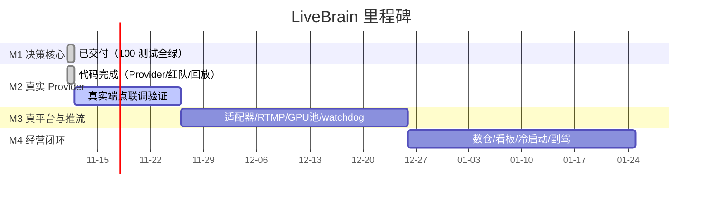

# 路线图（对应 DESIGN.md §11，进度事实见 PROGRESS.md）

## M1：决策核心垂直切片 ✅ 已交付（2026-11-11，提交 4f300d5）

- [x] 自研编排器（asyncio，确定性驱动，ZCode 仅作开发工具链）
- [x] 三轨决策：快轨规则 / 中轨 RAG+填槽 / 兜底池
- [x] 填槽制：LLM 零接触数字，校验失败重试 1 次落保守模板
- [x] 弹幕消毒（注入隔离）+ 意图白名单 + 敏感/诱导固定模板
- [x] 滑动窗口聚合 + 回复率预算
- [x] 话术原子 + 承诺队列 + 自由承诺词拦截
- [x] 三道过滤 + 品类宣称引擎（资质旗标）
- [x] 场控阶段状态机（滞回）+ 人设管理（切换约束、数字无关装饰）
- [x] 流式管线：切句→TTS→渲染→标识→帧哈希；打断协议（50ms 淡出+250ms 过渡）
- [x] AI 标识门禁（未武装不出帧）+ 报备前置校验
- [x] 降级链熔断 + 切换审计 + 回滚
- [x] 审计哈希链（AI 话术 + 人工操作 + 帧检查点）+ verify
- [x] 人工接管/交回（含未核销承诺清点）+ 人工操作审计
- [x] 判罚事件接入 → 升级降权（只走保守模板）→ 人工确认恢复
- [x] 模拟平台 + 端到端测试 80 个全绿

## M2：真实 Provider 与数据层 🔶 代码完成（2026-11-11，提交 97bd0e7）

**已交付：**
- [x] OpenAI 兼容 LLM Provider（Ark/DeepSeek/vLLM 通用，零依赖，transport 可注入测试）
- [x] EdgeTTS Provider（验证期专用；未安装优雅降级；不入商用链）
- [x] filler 等待期衔接话术（LLM 延迟期间垫话，正式回答到达即取代，默认关闭）
- [x] 红队弹幕集 40 条独立资产 + 资产驱动回归测试
- [x] 回放测试工具（录制/回放/四不变量校验：哈希链/注入隔离/出稿干净/承诺核销）
- [x] PG+pgvector DDL、docker-compose、config.example.json
- [x] 测试 80 → 100 全绿

**已交付（续，V4.2 增补）：**
- [x] 混播引擎：排班器 + 真人采集通道（Mock 25fps）+ 画面交叉淡化 + 标识跟随内容源 + 切回承诺门
- [x] 形象资产管理：真人底模肖像授权校验 + 平台报备绑定 + 开播门禁
- [x] 单间双主播设计（DESIGN §10.1）
- [x] 测试 100 → 117 全绿

**联调待办（需外部资源）：**
- [ ] 真实 Ark 端点联调：填槽拦截率实测 = 100%（需 ARK_API_KEY）
- [ ] edge-tts 真机合成试听与音色映射微调（本机已装 7.3.1）
- [ ] MuseTalk/OpenTalking 渲染 Provider（需 GPU）
- [ ] PG 实例数据层切换（compose 起库后接口平移）

## M3：真平台与推流 ⏳ 未启动（前置：平台开放者资质、GPU 环境）

- [ ] 首发平台适配器（事件 WebSocket + 运营动作 API + compliance profile）
- [ ] RTMP 推流（双路、断流重连）与渲染器解耦
- [ ] 多直播间编排器实例 + GPU 池调度（画质档位分配）
- [ ] 渲染实例故障迁移（无状态化 + 人设基线恢复）
- [ ] 观众侧 watchdog（口型/静音/冻屏检测）
- [ ] TTS/渲染降级链运行时切换接线（熔断器已就绪）
- [ ] 真人采集实装（OpenCV/采集卡/NDI 替换 MockHumanCapture）
- [ ] 单间双主播实施（设计已就绪：DESIGN §10.1 多通道模型）

验收：连续 4 小时模拟推流稳定；打断端到端 <1.5s。

## M4：经营与冷启动 ⏳ 未启动

- [ ] ClickHouse 数仓 + 话术效果热力图 + 直播间健康度看板
- [ ] 冷启动：历史直播回放 ASR→QA 抽取→人工确认入库
- [ ] 行业知识库种子包（食品/日用/服饰）
- [ ] 副驾模式灰度（AI 只做场控提示不出镜 → 逐步放权）
- [ ] 单间成本模型（GPU 摊销 + token + TTS 字符 + 带宽）

验收：看板指标齐；副驾模式试点商家跑通。
